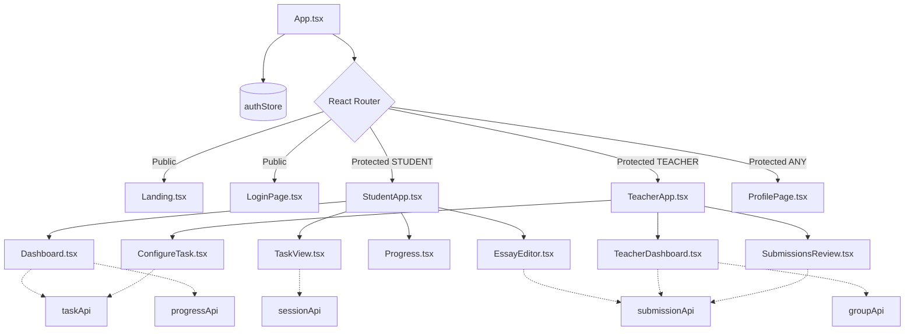
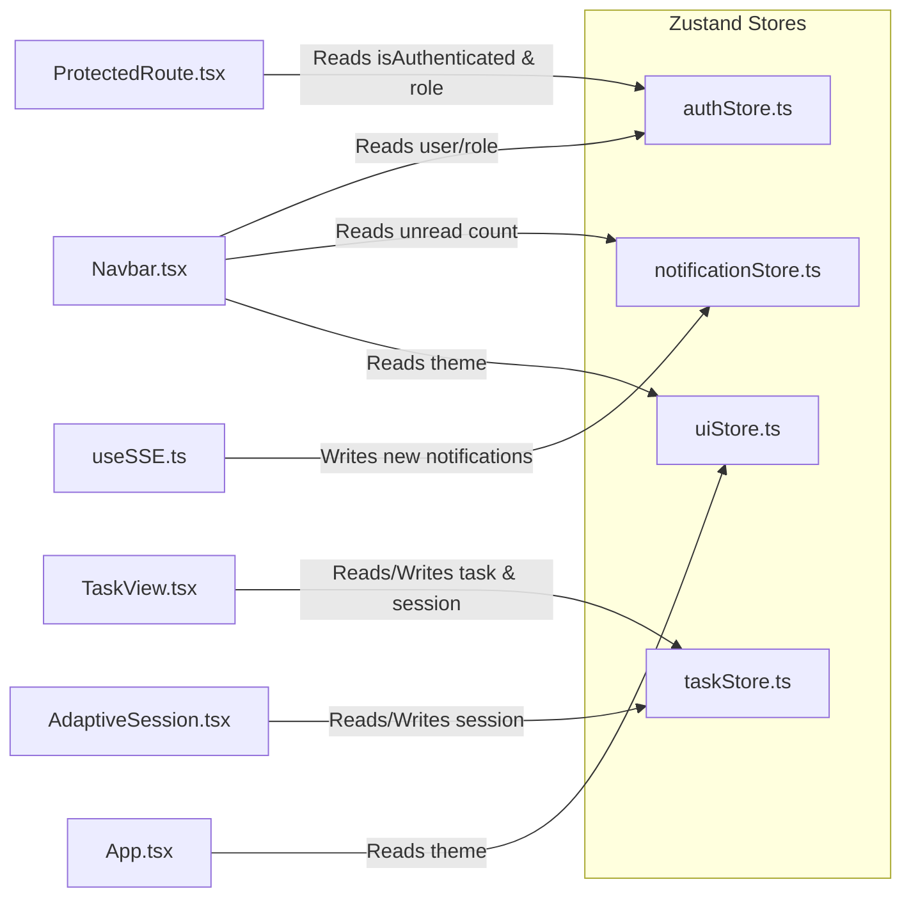

# Lingua Optima: Frontend Documentation

> **Documentation Navigation**: [Main Overview (README.md)](./README.md) | [Backend (BACKEND.md)](./BACKEND.md) | [Frontend (FRONTEND.md)](./FRONTEND.md) | [AI & OCR (AI_INTEGRATION.md)](./AI_INTEGRATION.md) | [DevOps (DEVOPS.md)](./DEVOPS.md) | **[Open Presentation (presentation.html)](./presentation.html)** | [Doxygen HTML](index.html)

Comprehensive documentation for the frontend application of **Lingua Optima** — an AI-powered English language mastery platform.

## Key Design Decisions

1. **No Global Leaderboard.** Only a group-level leaderboard is provided (strictly scoped within a specific teacher's student group).
2. **Token Storage:** The short-lived Access JWT is stored exclusively in JavaScript memory (NEVER in `localStorage`). The Refresh token is stored in a secure `HttpOnly` cookie.
3. **PWA (Progressive Web App):** Uses a Service Worker for asset and API caching, `IndexedDB` for persisting local drafts, and Background Sync for deferred submission delivery when offline.
4. **Axios Interceptor:** Implements silent JWT refresh — the response interceptor catches HTTP 401 errors, refreshes the access token in the background, and transparently retries the original request without interrupting the user experience.
5. **Real-Time Notifications:** Uses Server-Sent Events (SSE) to receive live notifications in real time.
6. **Strictly Scoped `localStorage` Usage:** Used exclusively for essay drafts (auto-saved every 30 seconds), non-sensitive UI preferences, and storing the last selected CEFR level.
7. **2-Step Email Registration:** When registering via email and password, the interface enforces a 2-step flow. First, user details are submitted to dispatch a 6-digit confirmation code via Gmail SMTP; second, the user enters the received code with a 60-second resend cooldown timer to complete account creation. Google OAuth2 registration provides seamless 1-click onboarding.
8. **External Automated Translation Widget:** To avoid bloated or incomplete hardcoded translation dictionaries, a global `TranslatorDropdown` component in the Navbar enables on-page translation via official Google Translate widget (with full language picker, RU/ES/DE/FR/ZH/AR/TR support, and 1-click reversion back to original English).
9. **Mobile-First Navigation & UX:** Features a persistent `MobileBottomNav` on mobile viewports (<768px) providing one-thumb access to core workspaces, optimized touch interaction (`touch-action: manipulation`), responsive card layouts for tables, and accessible touch target sizes.
10. **Printable Academic Reports & Date-Range Filtering:** Educator reporting module (`ExportReports.tsx`) supports date-range presets (All Time, Last 7 Days, Last 30 Days, This Month, Custom Range) and clean paper/PDF print preview via dedicated `@media print` CSS styles.
11. **Card Focus Mode (Step-by-Step) with Instant Feedback:** `TaskView.tsx` supports three distinct presentation modes: Classic List, Card Focus Mode (single question at a time with keyboard hotkeys `1-4`, `ArrowLeft`/`ArrowRight`, and `Enter`), and Classroom Presentation Mode. Card Focus features optional Instant Feedback (`Мгновенная проверка`) highlighting answers immediately with checkmark/cross badges and embedded grammar explanations.
12. **Classroom Live Presentation Mode:** Designed for smartboards and projectors with extra-large typography, fullscreen mode, and interactive `[ 👁️ Показать ответ ]` / `[ 🙈 Скрыть ответ ]` toggle per question.
13. **Sentence AI Explainer Engine:** Allows students to highlight any sentence in reading passages or click `[ 💡 Пояснить ]` on any exercise item to view contextual Russian translation, grammatical breakdown, and key vocabulary via `POST /api/tasks/explain-sentence`.
14. **Smart Recommended Practice:** `QuickModePanel.tsx` features an intelligent `Recommended` format that queries `progressApi.getGaps()` to automatically target the student's weakest grammar topic or foundational CEFR unit.
15. **Zero-Dependency Confetti Celebration:** `src/utils/confetti.ts` renders dynamic particle confetti using HTML5 Canvas upon achieving scores $\ge 90\%$.

## Complete File Structure

```text
frontend/
├── public/
│   ├── manifest.json          — PWA manifest (name, theme_color #4F46E5, icons)
│   ├── sw.js                  — Service Worker (cache strategies)
│   ├── favicon.svg
│   └── icons/                 — PWA icons 192x192, 512x512
├── src/
│   ├── main.tsx               — Entry point, React root
│   ├── App.tsx                — Router setup, layout wrapper
│   ├── vite-env.d.ts
│   ├── index.css              — Tailwind imports + CSS variables + translation overlay rules
│   │
│   ├── constants/             — Shared application constants
│   │   └── aiModels.ts        — Up-to-date 2026 AI provider and model catalog (DeepSeek, Qwen, Kimi, Gemini, Groq, OpenAI, Anthropic)
│   │
│   ├── api/                   — HTTP layer (all backend communication)
│   │   ├── axiosInstance.ts   — Base axios config, JWT interceptor (silent refresh), error handling
│   │   ├── authApi.ts         — login(), register(code), googleLogin(), refresh(), logout(), sendVerificationCode()
│   │   ├── taskApi.ts         — generateTask(), getTasks(), assignTask(), previewTask()
│   │   ├── sessionApi.ts      — startSession(), getNextQuestion(), submitAnswer(), completeSession(), getActiveSession()
│   │   ├── submissionApi.ts   — submitText(), submitImage(), getSubmissions(), overrideScore()
│   │   ├── progressApi.ts     — getMyProgress(), getStudentProgress(), getGroupProgress()
│   │   ├── groupApi.ts        — getGroups(), createGroup(), addStudent(), removeStudent(), deleteGroup(), getGroupTasks(), transferTask()
│   │   ├── notificationApi.ts — connectSSE(), markAsRead()
│   │   ├── subscriptionApi.ts — getMyTier(), getUsage(), upgradeTier()
│   │   ├── apiKeyApi.ts       — getKeys(), saveKey(provider, rawKey, modelName), deleteKey()
│   │   ├── exportApi.ts       — downloadGroupReport(), downloadStudentReport()
│   │   └── leaderboardApi.ts  — getGroupLeaderboard(groupId)
│   │
│   ├── components/
│   │   ├── common/            — Shared UI components
│   │   │   ├── Navbar.tsx     — Logo, streamlined primary navigation links + compact "More ▾" dropdown for secondary learning tools & educator actions, notifications bell + counter, avatar dropdown with 1-click instant Role Switcher (Student ⇄ Teacher), remaining daily evaluations badge, and global TranslatorDropdown
│   │   │   ├── MobileBottomNav.tsx — Persistent bottom navigation bar on mobile viewports (<768px) with quick access to dashboard, tasks, progress, units, cohorts, and grading
│   │   │   ├── TranslatorDropdown.tsx — Automated website translation menu integrating official Google Translate widget with multilingual picker and English revert
│   │   │   ├── Footer.tsx     — Navigation links to Privacy Policy (/privacy), Terms of Service (/terms), Help Center (/help), Presentation, and © Lingua Optima
│   │   │   ├── QuickModePanel.tsx — Streamlined 1-click practice and assignment mode with CEFR level, format selector (Surprise Mix, Grammar Quiz, Reading Article, Speaking Drill), topic shuffle (🎲), custom topic override, and automatic parameter randomization with token-saving Eco Mode active by default
│   │   │   ├── TopicSelector.tsx — Reusable CEFR topic selector with domain categorization, curriculum catalog, and custom topic input
│   │   │   ├── CustomSelect.tsx — Accessible dropdown select with custom styled menu items
│   │   │   ├── ProtectedRoute.tsx — Checks auth + role, redirects to /login
│   │   │   ├── RoleGuard.tsx  — Shows different content based on STUDENT/TEACHER role
│   │   │   ├── UpgradeWall.tsx — Modal: 'Upgrade to continue' with [Upgrade to Premium] and [Use own API key] options
│   │   │   ├── OfflineBanner.tsx — navigator.onLine indicator in Navbar
│   │   │   ├── CefrBadge.tsx  — Colored badge showing full CEFR scale (A1, A2, B1, B2, C1, C2)
│   │   │   ├── LoadingSpinner.tsx
│   │   │   ├── ErrorBoundary.tsx
│   │   │   ├── Toast.tsx      — Notification toast component
│   │   │   ├── ConfirmDialog.tsx
│   │   │   ├── AnnotatedTextReview.tsx — Modular inline mistake highlighting component rendering red error marks (<mark>), popovers with mistake description, suggested rewrites, and grammar rules. Supports teacher interactive editing mode (adjust explanations, delete false positives, select text to add new errors) and student review mode
│   │   │   └── SpeakingPracticeView.tsx — Interactive student oral speaking and pronunciation practice interface. Features real-time voice capture via Web Speech API, word-level acoustic alignment (Levenshtein distance), IPA phonetic transcription hints, audio TTS playback with accent switcher (US/UK), speech tempo calculation (WPM), and composite scoring (Accuracy, Fluency, Completeness)
│   │   │
│   │   ├── student/           — Student-only components
│   │   │   ├── Dashboard.tsx          — Streak counter, CEFR progress bar, Learning Modules & Practice Modes grid (AI Generator, Essay Studio, Photo OCR, Adaptive CAT, My Units, Progress), active assignments with smart essay/grammar routing, grammar gaps
│   │   │   ├── GenerateTask.tsx       — Student task creation studio featuring Mode Switcher (Quick Practice vs Detailed Studio), modular studio views (GrammarConfigPanel, ReadingConfigPanel, SpeakingConfigPanel), AI provider and model selector, teacher-shared curriculum rules, and animated generation progress banner
│   │   │   ├── TaskView.tsx           — Task title + CEFR badge, sanitized task instructions, automatic redirection for ESSAY tasks to Essay Studio. For Reading Comprehension: responsive two-column split layout with sticky reading article, interactive window scaling controls (column width presets 35%, 50%, 58%, 67% with auto-expanding widescreen container up to max-w-7xl, typography font resizing toolbar A-/A+ with 4 size presets sm/base/lg/xl, and full-height scroll toggle), live answered progress indicator (X of Y answered), pre-submit ConfirmDialog modal warning against uncompleted questions, in-flight grading status banner, and queue/retry error panel. Buttons: [Submit Answers] [Save Draft] [← Back]
│   │   │   ├── AdaptiveSession.tsx    — Interactive CAT Diagnostic Hub (IRT calibration guide, task picker) + In-flight CAT test runner (single question, difficulty indicator, progress bar, answer feedback). Handles resume from GET /sessions/active
│   │   │   ├── OcrSubmit.tsx          — Drag&drop zone / [Browse File] button, image preview, hint 'deleted after processing'. Buttons: [Analyse Photo] [Clear Photo]
│   │   │   ├── EssayEditor.tsx        — Sanitized essay topic & scenario, guiding discussion points list, CEFR target badge, textarea (min 250 words), live word counter, auto-save to localStorage every 30s, in-flight IELTS/Cambridge evaluation progress banner (10-25s notice), and queue/retry error panel. Buttons: [Submit for Scoring] [Save Draft]
│   │   │   ├── AIReview.tsx           — Sentence-by-sentence evaluation with tri-state status (Correct / Needs Revision / Skipped 0 pts), integrated AnnotatedTextReview for inline red mistake highlighting on submitted essays and texts, score banner with Attempt Accuracy breakdown, strict mutual exclusion between Mastered Concepts and Identified Weaknesses, essay rubric breakdown (TA/Coherence/LR/GR out of 10), and 1-click targeted practice CTA. Buttons: [Save to My Units] [Practice This Topic] [Share Result]
│   │   │   ├── MyUnits.tsx            — Filters: CEFR/Topic/Domain/Date. Task cards with name/date/score/type. Buttons per card: [Retry Task] [Delete]
│   │   │   ├── Progress.tsx           — Grammar mastery radar chart, timeline score graph, topic/errors/mastery table, AI recommendations. Button: [Generate Targeted Task]
│   │   │   ├── GroupLeaderboard.tsx   — Group-only leaderboard with cohort selector. Shows rank, customizable display alias (defaults to full name), CEFR level, task completion progress (X/Y tasks, progress bar, %), average score, study streak, and weekly score. NO global leaderboard.
│   │   │   └── LevelUpModal.tsx       — Dynamic progression modal across all 6 levels (A1→A2→B1→B2→C1→C2) with [Yes, level up] [Stay on current level] buttons
│   │   │
│   │   ├── teacher/           — Teacher-only components
│   │   │   ├── TeacherDashboard.tsx   — Educator Command Center: summary stats, Educator Toolkit & Modules grid (Cohorts, Configurator, Submissions, Reports), student groups list with quick actions
│   │   │   ├── StudentGroups.tsx      — Dual-tab cohort management: Students & Roster (search, CEFR filters, hide/unhide, pagination, student alias renaming) and Assigned Tasks (completion metrics, avg score, due dates). Includes Transfer / Move / Copy Assignment modal between educator cohorts. Buttons: [+ New Group] [+ Add Student] [Transfer / Copy] [Assign Task]
│   │   │   ├── ConfigureTask.tsx      — Multi-cohort simultaneous assignment generator & deployer. Features Mode Switcher (Quick Mode vs Detailed Studio), isolated studios without duplicate fields, live preview editor, and single source of truth for total assignment points
│   │   │   ├── GrammarConfigPanel.tsx — Dedicated modular configuration panel for grammar exercises (MCQ, GAP_FILL, OPEN_BRACKETS, REWRITE). Encapsulates topic selection, domain, difficulty, question count, Eco Mode, and target rules & vocabulary library
│   │   │   ├── ReadingConfigPanel.tsx — Dedicated reading comprehension configuration menu with custom assignment title, text length presets (Short/Medium/Long/Custom with numeric 50-1000 word counter), paragraph narrative structure guidance, target vocabulary keywords, CEFR lexical level, question mode switcher (Surprise Me Random Mix vs Custom Selection), question counters for MCQ, True/False, and Open-ended questions, and per-category point weight budgeting
│   │   │   ├── SpeakingConfigPanel.tsx — Dedicated speaking assignment configuration panel. Integrates CEFR JSON pronunciation packs (A1-C2), minimal pairs cards with TTS audio, articulatory contrast explanations, Eco Mode toggle, scenario instructions, and duration presets
│   │   │   ├── SubmissionsReview.tsx  — Educator review queue (`GET /api/submissions/teacher`) strictly isolated to taught student submissions. Search by student/group/task, status filter, hide/unhide toggles, pagination. Integrated AnnotatedTextReview in editable mode (educator can click red highlights to edit explanations, delete error highlights, select text to highlight new errors), clickable question item correctness toggles, and persistent override saving via submissionApi.overrideScore without clobbering AI telemetry
│   │   │   └── ExportReports.tsx      — Cohort performance report generator (PDF/CSV) featuring comprehensive breakdown across all assigned homeworks, student submission statuses, attempt counters, scores, and teacher commentary
│   │   │
│   │   └── auth/              — Auth pages
│   │       ├── LoginPage.tsx          — Tab: Log In / Register. Log In (email/pass + Google OAuth). Register: 2-step flow (Step 1: details + code dispatch via Gmail SMTP; Step 2: 6-digit confirmation code input with 60s cooldown timer + submit) or 1-click Google OAuth
│   │       └── ForgotPassword.tsx     — Email input, [Send Reset Link] button
│   │
│   ├── hooks/                 — Custom React hooks
│   │   ├── useAuth.ts         — Current user, isAuthenticated, login(), logout(), register()
│   │   ├── useSSE.ts          — SSE connection management, auto-reconnect on disconnect
│   │   ├── useUsage.ts        — Remaining evaluations, checks quota before AI calls
│   │   ├── useOnline.ts       — navigator.onLine state
│   │   ├── useDraft.ts        — localStorage draft save/load/clear
│   │   └── useDebounce.ts
│   │
│   ├── store/                 — State management (Zustand)
│   │   ├── authStore.ts       — User, tokens, role
│   │   ├── notificationStore.ts — Unread count, notification list
│   │   ├── taskStore.ts       — Current task, session state
│   │   └── uiStore.ts         — Theme, sidebar collapsed, etc.
│   │
│   ├── types/                 — TypeScript interfaces
│   │   ├── user.ts            — User, Role ('STUDENT' | 'TEACHER' | 'ADMIN'), CefrLevel ('A1' | 'A2' | 'B1' | 'B2' | 'C1' | 'C2')
│   │   ├── task.ts            — Task, TaskQuestion, TaskParams (with provider & modelName), TaskType
│   │   ├── submission.ts      — Submission, SubmissionResult, EssayScore
│   │   ├── session.ts         — SessionState, AnswerFeedback
│   │   ├── group.ts           — Group, GroupStudent, GroupTask, TransferTaskRequest
│   │   ├── subscription.ts    — SubscriptionTier, UsageCounter
│   │   ├── notification.ts    — Notification, NotificationType
│   │   └── progress.ts        — ProgressRecord, GroupProgress
│   │
│   ├── utils/                 — Utility functions
│   │   ├── formatDate.ts
│   │   ├── cefrColors.ts      — Color mapping for CEFR badges (A1 teal, A2 cyan, B1 emerald, B2 sky, C1 purple, C2 amber)
│   │   ├── wordCount.ts       — Essay word counter
│   │   ├── textSanitizer.ts   — Sanitizes task content and AI feedback to strip internal system prompt markers
│   │   ├── offlineSync.ts     — IndexedDB + Background Sync logic
│   │   └── phonetics.ts       — 200+ IPA dictionary, suffix heuristics, Levenshtein speech alignment, and TTS audio synthesis
│   │
│   └── pages/                 — Route-level page components
│       ├── Landing.tsx        — Hero block, 6 feature cards, [Get Started] [Log In] [View Demo] buttons
│       ├── StudentApp.tsx     — Layout wrapper for student routes
│       ├── TeacherApp.tsx     — Layout wrapper for teacher routes
│       ├── ProfilePage.tsx    — Avatar, name, email, role toggle (Student ⇄ Educator), 6-level CEFR selector (A1–C2), platform FAQ guide, AI Provider & Model BYOK section (7 providers: DeepSeek, Qwen, Kimi, OpenAI, Anthropic, Gemini, Groq with modern 2026 models & AES-256-GCM encryption)
│       ├── SubscriptionPage.tsx — Free/Premium/Educator tier cards, current plan highlight, [Upgrade] buttons, payment stub
│       ├── PrivacyPolicy.tsx  — Zero-Retention OCR RAM-only architecture guarantee, AI evaluation transparency, and GDPR/CCPA data rights
│       ├── TermsOfService.tsx — Academic integrity, educator review authority, and fair use tier quotas
│       ├── HelpCenter.tsx     — Searchable FAQ knowledge base with category filters and interactive question accordions
│       └── NotFound.tsx
│
├── tailwind.config.ts         — Colors (#4F46E5, #0284C7, #F8FAFC), fonts (Inter, JetBrains Mono)
├── vite.config.ts
├── tsconfig.json
├── package.json
└── .env.example               — VITE_API_URL=http://localhost:8080/api
```

## Component Interaction Diagram



## State Management Diagram



## Routing Table

| Path | Component | Role Required | Description |
|------|-----------|---------------|-------------|
| `/` | `Landing.tsx` | *None* | Public landing page for unauthenticated visitors. |
| `/login` | `LoginPage.tsx` | *None* | Sign-in and registration page (Email/Password + Google OAuth2). |
| `/forgot-password` | `ForgotPassword.tsx` | *None* | Password reset request page. |
| `/privacy` | `PrivacyPolicy.tsx` | *None* | Public Privacy Policy highlighting Zero-Retention OCR and GDPR rights. |
| `/terms` | `TermsOfService.tsx` | *None* | Public Terms of Service outlining educator authority and fair use quotas. |
| `/help` | `HelpCenter.tsx` | *None* | Public Help Center with searchable FAQ and interactive category filters. |
| `/student/*` | `StudentApp.tsx` | `STUDENT` | Primary student workspace (Dashboard, Tasks, CAT Sessions, Progress). |
| `/teacher/*` | `TeacherApp.tsx` | `TEACHER` | Primary educator portal (Groups, Submissions Review, Task Deployment). |
| `/profile` | `ProfilePage.tsx` | `STUDENT`, `TEACHER` | Profile management, BYOK API key configuration, and preferences. |
| `/subscription` | `SubscriptionPage.tsx` | `STUDENT`, `TEACHER` | Subscription plan management and weekly quota monitoring. |
| `*` | `NotFound.tsx` | *None* | 404 Not Found fallback page. |

## PWA Details

The application implements full Progressive Web App (PWA) support to ensure a resilient user experience on unstable network connections:

- **Service Worker:** Employs hybrid caching strategies (*Cache First* for static assets and fonts, *Network First* for critical dynamic API calls).
- **IndexedDB:** Used for local persistence of active task structures and draft responses. The client database schema includes object stores for `drafts` and `offline_submissions`.
- **Background Sync:** Built-in Service Worker capability that queues outbound submissions (such as essay submissions) while offline and automatically replays them once connectivity is restored, notifying the user that their work has been queued for synchronization.

## Design System

- **Colors:**
  - **Primary:** `#4F46E5` (Used for primary action buttons, active navigation states, and brand accents)
  - **Accent:** `#0284C7` (Used for secondary interactive actions and links)
  - **Surface:** `#F8FAFC` (Background color for cards, panels, and workspaces)
- **Typography:**
  - **UI (Headings & Body Text):** `Inter`
  - **Data (Code, Metrics & Tables):** `JetBrains Mono`
- **Accessibility:** All color contrast ratios and font sizes conform to the **WCAG AA** accessibility standard.

---

## Reading Comprehension Studio & Diagnostic Error Review

### 1. Reading Comprehension Studio
- **ReadingConfigPanel (`frontend/src/components/teacher/ReadingConfigPanel.tsx`)**:
  - Configures passage topic, length presets (`Short 150-250w`, `Medium 300-450w`, `Long 500-700w`, `Custom`), paragraph narrative guidelines, CEFR lexical level, and target vocabulary keywords.
  - Multi-question breakdown selector: configure counts and points per category for Multiple Choice (`MCQ`), True/False/Not Given (`True / False`), and Sentence Completion / Open-Ended questions.
  - Live aggregate points counter automatically sums category subtotals.
- **Passage & Questions Editor (`ConfigureTask.tsx`)**:
  - Live 9-line expandable passage textarea editor allows educators to tweak AI-generated text passages.
  - Question conversion buttons: 1-click conversion between open-ended and choice-based questions.
  - Granular option, answer, and point customization for each question.
- **Student Split Solving Workspace (`TaskView.tsx`)**:
  - Responsive two-column split layout: sticky left pane contains readable passage with live word counter; right pane displays questions with category badges, point values, radio choices, and open textareas.

### 2. Diagnostic Mistake Annotation
- **AnnotatedTextReview (`frontend/src/components/common/AnnotatedTextReview.tsx`)**:
  - Displays submitted essay or text with inline red error marks (`<mark className="bg-rose-100 border-b-2 border-rose-500...">`).
  - Interactive popovers: clicking or hovering displays the exact error, suggested revision, grammar rule, and pedagogical explanation.
  - Educator editing controls:
    - Edit explanation: clicking a highlight opens an inline editor to update explanations.
    - Remove error: 1-click removal of false-positive highlights.
    - Add error: selecting any text span in the review opens a prompt to create a new targeted correction.
- **Teacher Review Integration (`SubmissionsReview.tsx`)**:
  - Educator reviews student homework with full diagnostic tools.
  - Clickable question item badges toggle item correctness between correct and incorrect.
  - "Save Diagnostic Adjustments" button commits adjusted corrections, items, comments, and scores to backend via `submissionApi.overrideScore(...)`.

---

## Speaking & Pronunciation Practice Studio

### 1. Zero-Cost Speech Recognition & Phonetic Alignment Architecture
- **In-Browser Execution ($0 API Cost)**: Utilizes native browser speech recognition (`webkitSpeechRecognition` / `SpeechRecognition`) and native speech synthesis (`window.speechSynthesis`). Avoids expensive recurring per-minute speech API fees.
- **Pluggable Modular Design**: The engine is wrapped behind a clean interface (`PronunciationResult`, `alignSpokenWords`). It functions standalone in modern web browsers and can be upgraded seamlessly to proprietary cloud speech assessment APIs (e.g. Azure Speech Assessment or Whisper) without changing client contracts.

### 2. Phonetics Utilities (`frontend/src/utils/phonetics.ts`)
- **IPA Transcription Engine (`getIpaTranscription`)**: Built-in 200+ word dictionary covering phonetically complex dental fricatives (`/θ/`, `/ð/`), liquids (`/r/`, `/l/`), labials (`/v/`, `/w/`), vowel pairs, and silent letters, backed by morphological suffix heuristics (`-ing`, `-ly`, `-ed`, `-s`).
- **Levenshtein Alignment (`alignSpokenWords`)**: Matches recognized spoken words against reference tokens. Categorizes words into:
  - `CORRECT` (green): Accurately articulated words.
  - `MISPRONOUNCED` (red): Substituted or slurred words, tagged with actionable articulatory placement tips (e.g., tongue position between teeth for dental fricatives).
  - `OMITTED` (amber/strikethrough): Skipped or inaudible words.
- **Scoring Formulas**: Computes independent Accuracy, Completeness, and Fluency sub-scores to generate an overall Pronunciation Score (0–100%).
- **Speech Synthesis (`speakWord`, `speakText`, `stopSpeech`)**: Natural speech playback with accent selection (`en-US` and `en-GB`).

### 3. Educator Configuration (`SpeakingConfigPanel.tsx`)
- Configures assignment title, target phonemes, passage length presets (`Short 30–50w`, `Medium 60–90w`, `Long 120–180w`, `Custom`), scenario instructions, and total points.
- Integrates calibrated CEFR JSON Pronunciation Packs (A1–C2) with minimal pair contrast exploration.
- Eco Mode switch: toggles between enriched phonetic guidance and token-saving lightweight prompt compiling.
- Live TTS audio tester allows instant verification of speaker audio across US and UK accents.

### 4. Student Practice Workspace (`SpeakingPracticeView.tsx`)
- Displays target phoneme focus badges, points, and passage word chips.
- Click any individual word to hear native pronunciation and inspect its IPA transcription.
- Real-time speech recognition recording with live duration timer (`00:15`) and interim transcript feedback.
- **Speech Rate & Pacing Engine (`phonetics.ts`)**:
  - Dynamically computes reading speed in Words Per Minute (WPM): `Math.round(spokenWordCount / elapsedMinutes)`.
  - Calibrates pacing score with a calibrated Gaussian-style comfort curve: 100% optimal for 100–160 WPM, smoothly descending for rushed (>180 WPM) or halting (<80 WPM) cadence.
  - Automatically generates actionable pacing tips in `generalFeedback`.
- **Diagnostic Stats Quad**:
  - Displays 4 key performance metrics: Pronunciation Accuracy (%), Speech Speed (WPM with gauge indicator), Mispronounced Words count, and Recording Duration (seconds).
- Comprehensive evaluation breakdown with color-coded word highlights, word-by-word articulation popovers, and overall accuracy badges.

### 5. Educator Submission Diagnostics (`SubmissionsReview.tsx`)
- Dedicated oral speaking diagnostic banner displaying accuracy score, speech rate (WPM), recording duration, pacing analysis, spoken transcript, and reference text.
- One-click native TTS audio playback of student's spoken words or model reference passage.
- Score override and teacher comments editing.

### 6. JSON Pronunciation Packs & Minimal Pairs Studio
- **Curriculum Integration**: Fetches calibrated pronunciation packs via `taskApi.getPronunciationPacks(cefrLevel)`.
- **Minimal Pair Contrast Cards**: Interactive cards for vowel contrasts (e.g., `/iː/` vs `/ɪ/` sheep/ship), consonant contrasts (`/θ/` vs `/s/` think/sink, `/v/` vs `/w/` vest/west), and rhythm drills.
- **Audio Articulation Audition**: Each word in a minimal pair card has an interactive TTS speaker button allowing students and educators to hear the contrast side-by-side with phonetic explanations.
- **Eco Mode Support**: Integrated toggle in the speaking studio. When active, prompt payload excludes verbose phonetic word lists, saving tokens and lowering generation latency.

---

## Modular Task Studios & Single Source of Truth

### 1. Isolated Studio Architecture
To eliminate UI duplication and configuration clutter:
- **`GrammarConfigPanel`**: Encapsulates all discrete grammar exercises (`MCQ`, `GAP_FILL`, `OPEN_BRACKETS`, `REWRITE`). Centralizes domain, CEFR topic selection, difficulty slider, question counts, Eco Mode, and custom curriculum integration.
- **`ReadingConfigPanel`**: Encapsulates reading comprehension configuration (`READING`), passage length presets (Short/Medium/Long/Custom), paragraph structure guidance, target vocabulary, and point budgeting across MCQ, True/False, and Open-ended question types.
- **`SpeakingConfigPanel`**: Encapsulates oral speech exercises (`SPEAKING`), target sounds, CEFR pronunciation packs, minimal pairs cards, and scenario instructions.
- Only the panel corresponding to the active task type is rendered in both `GenerateTask.tsx` and `ConfigureTask.tsx`.

### 2. Elimination of Parameter Duplication
- **Total Points Single Source of Truth**: For reading assignments, points are computed directly from category subtotals. For all other formats, a single points counter appears prior to the deployment/generation action.
- **Curriculum Library Synchronization**: Teacher-created custom rules and vocabulary sets are seamlessly shared with enrolled students. In `GrammarConfigPanel`, custom rules can be saved directly to the user's library without modal barriers.

---

## Quick Practice Mode & Zero-Friction Flow

### 1. QuickModePanel (`frontend/src/components/common/QuickModePanel.tsx`)
- Designed for immediate 1-click practice without navigating dozens of configuration sliders.
- **Core Parameters**:
  - **CEFR Level**: Quick selector (A1–C2).
  - **Format**: 4 streamlined options:
    - `Surprise Mix`: Random selection between grammar, reading, or speaking exercises.
    - `Grammar Quiz`: Multiple choice and gap-fill exercises.
    - `Reading Article`: Coherent reading text with comprehension checks.
    - `Speaking Drill`: Pronunciation and oral reading exercise.
  - **Topic Selection**: Built-in 1-click random shuffle button (`🎲 Random Topic`) with instant rotation across CEFR topics, plus custom topic input support.
- **Automatic Parameter Randomization**: Automatically calibrates question count (3–6), difficulty (Easy to Hard), domain (General/Academic/Business), and sets Eco Mode to ON for rapid generation and minimal token consumption.
- **Universal Availability**: Integrated into both Student Self-Service (`GenerateTask.tsx`) and Educator Homework Configurator (`ConfigureTask.tsx`).

---

## License and Copyright

Copyright (c) 2026 **Maksim Manastyrski**. All rights reserved.  
Licensed under the **[MIT License](../LICENSE)**.
